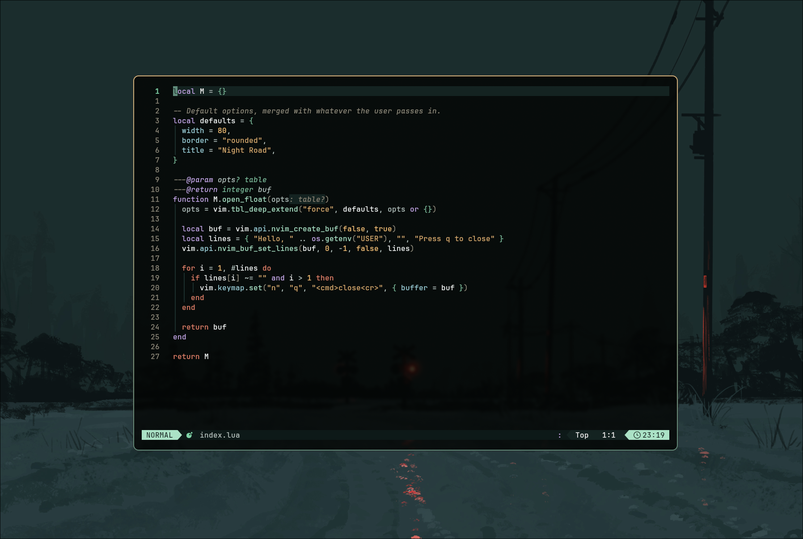

# night-road.nvim

A dark Neovim colorscheme with a deep green-teal background, mint accents,
gold constants and soft purple keywords, plus variants in other colors.



## Features

- Five variants: `night` (default), `blue-hour`, `forest`, `catppuccin`,
  `gruvbox`
- Treesitter and LSP semantic token highlights
- Diagnostics and diff highlights
- Plugin support: Telescope, nvim-cmp, blink.cmp, gitsigns, which-key,
  indent guides, neo-tree, nvim-tree, lazy.nvim, mason.nvim, Snacks
- Matching lualine theme
- Optional transparent background
- Terminal (ANSI) colors set for `:terminal`

## Requirements

- Neovim 0.12+
- A terminal with true color support

## Installation

## lazy.nvim

```lua
{
  "0xk3v/night-road.nvim",
  lazy = false,
  priority = 1000,
  config = function()
    require("night-road").setup({
      -- your options here
    })
    vim.cmd.colorscheme("night-road")
  end,
}
```

### packer.nvim

```lua
use({
  "0xk3v/night-road.nvim",
  config = function()
    require("night-road").setup()
    vim.cmd.colorscheme("night-road")
  end,
})
```

## Configuration

These are the defaults. You only need to pass what you want to change.

```lua
require("night-road").setup({
  variant = "night", -- see Variants below
  transparent = true, -- no background on Normal, signcolumn, etc.
  terminal_colors = true, -- set :terminal ANSI colors

  styles = {
    comments = { italic = true },
    keywords = { bold = false, italic = false },
    functions = { bold = false },
    variables = {},
  },

  integrations = {
    treesitter = true,
    lsp = true,
    diagnostics = true,
    plugins = true,
  },
})
```

Set `transparent = false` for a solid background.

## Variants

| Variant | Background | Accent | Keywords |
|---|---|---|---|
| `night` (default) | deep green-teal | mint | soft purple |
| `blue-hour` | deep blue | sky blue | violet |
| `forest` | deep green | lime | lilac |
| `catppuccin` | Catppuccin Mocha | peach | mauve |
| `gruvbox` | Gruvbox dark (hard) | orange | purple |

Pick one in `setup()`:

```lua
require("night-road").setup({ variant = "gruvbox" })
vim.cmd.colorscheme("night-road")
```

Or load one directly, without changing your options:

```vim
:colorscheme night-road-gruvbox
```

Every variant has a `night-road-<variant>` colorscheme. `night-road` itself
loads the variant from `setup()`.

`catppuccin` and `gruvbox` borrow those palettes but use night-road's highlight
groups. For the original themes, use
[catppuccin/nvim](https://github.com/catppuccin/nvim) or
[gruvbox.nvim](https://github.com/ellisonleao/gruvbox.nvim).

## lualine

```lua
require("lualine").setup({
  options = { theme = "night-road" },
})
```

The `night-road` theme uses the variant that was loaded last. Each variant also
has its own theme, `night-road-<variant>`, so `theme = "auto"` works with
`:colorscheme night-road-<variant>`.

## Using the palette

```lua
local colors = require("night-road").colors()
print(colors.green) -- #7fd3a8 in night
```

`colors()` returns the palette of the variant that was loaded last. Palette
keys are named after the hues of `night`, but each one is a role, so its
color depends on the variant: `green` is orange in `gruvbox`.

| Key | Role |
|---|---|
| `bg`, `bg_deep`, `surface`, `overlay` | Editor, sidebars and tabline, floats and cursorline, folds and quickfix line |
| `muted`, `subtle`, `text` | Comments and line numbers, secondary text, main text |
| `green` | Functions, cursor, headings |
| `teal_bright` | Function calls |
| `teal` | Types |
| `blue` | Modules, builtin types |
| `blue_bright` | Properties, members |
| `purple` | Keywords |
| `amber`, `amber_dim` | Numbers and constants, strings |
| `red`, `red_dim`, `red_bright` | Control flow, conditionals and loops, errors |
| `green_dim` | Dim accent |
| `git_add` | Git and diff additions (green in every variant) |
| `border`, `selection`, `selection_fg`, `search` | UI |
| `diff_add`, `diff_change`, `diff_delete` | Diff backgrounds |
| `ansi` | Optional list of the 16 terminal colors. Set in every variant except `night`, which derives them from the roles above |

## Development

Run the smoke tests from the project root:

```bash
nvim --headless -u NONE --cmd "set rtp+=." -l tests/colorscheme_spec.lua
```

## License

[MIT](LICENSE)
