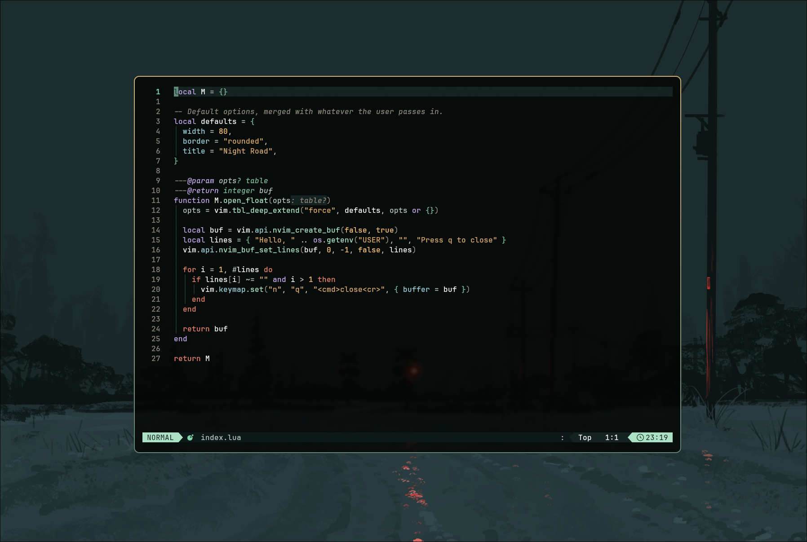

# night-road.nvim

A dark Neovim colorscheme with a deep green-teal background, mint accents,
gold constants and soft purple keywords.



## Features

- Treesitter and LSP semantic token highlights
- Diagnostics and diff highlights
- Plugin support: Telescope, nvim-cmp, blink.cmp, gitsigns, which-key,
  indent guides, neo-tree, nvim-tree, lazy.nvim, mason.nvim, Snacks
- Matching lualine theme
- Optional transparent background
- Terminal (ANSI) colors set for `:terminal`

## Requirements

- Neovim 0.12+
- A terminal with true color support

## Installation

## lazy.nvim

```lua
{
  "0xk3v/night-road.nvim",
  lazy = false,
  priority = 1000,
  config = function()
    require("night-road").setup({
      -- your options here
    })
    vim.cmd.colorscheme("night-road")
  end,
}
```

### packer.nvim

```lua
use({
  "0xk3v/night-road.nvim",
  config = function()
    require("night-road").setup()
    vim.cmd.colorscheme("night-road")
  end,
})
```

## Configuration

These are the defaults. You only need to pass what you want to change.

```lua
require("night-road").setup({
  transparent = true, -- no background on Normal, signcolumn, etc.
  terminal_colors = true, -- set :terminal ANSI colors

  styles = {
    comments = { italic = true },
    keywords = { bold = false, italic = false },
    functions = { bold = false },
    variables = {},
  },

  integrations = {
    treesitter = true,
    lsp = true,
    diagnostics = true,
    plugins = true,
  },
})
```

Set `transparent = false` for a solid background.

## lualine

```lua
require("lualine").setup({
  options = { theme = "night-road" },
})
```

## Using the palette

```lua
local colors = require("night-road").colors()
print(colors.green) -- #7fd3a8
```

## Development

Run the smoke tests from the project root:

```bash
nvim --headless -u NONE --cmd "set rtp+=." -l tests/colorscheme_spec.lua
```

## License

[MIT](LICENSE)
